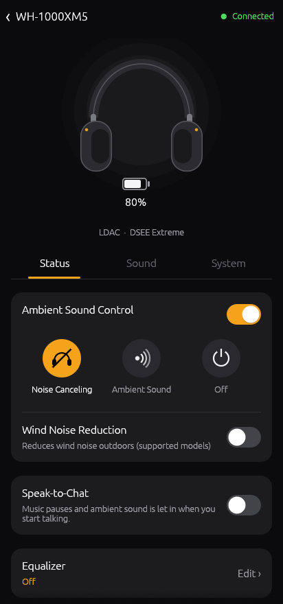
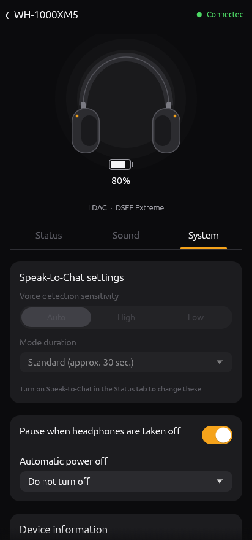
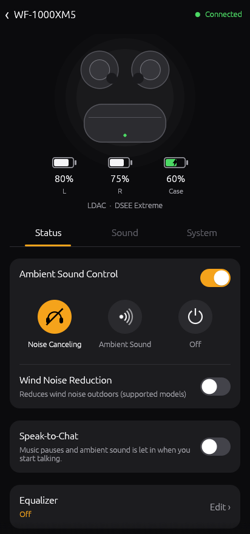

# Sony Audio Control

A desktop companion app for Sony Bluetooth headphones and earbuds, written in **100% safe Rust**
(`unsafe_code = "forbid"` is set for the whole crate, so the compiler rejects any `unsafe` block).

The interface is laid out like the mobile companion app: a phone-sized window with a product
illustration, battery levels, and **Status / Sound / System** tabs.

| Status | Sound | System | Earbuds |
|---|---|---|---|
|  |  |  |  |

> This is an independent, unofficial project. It is not affiliated with or endorsed by Sony.
> No Sony artwork or logos are bundled; the product illustrations are drawn with vector shapes.

## Features

| Feature | Where |
|---|---|
| Noise Canceling / Ambient Sound / Off | Status |
| Ambient sound level (1–20), Focus on Voice | Status |
| Wind Noise Reduction | Status |
| Speak-to-Chat on/off | Status |
| Battery (headphones; earbuds L / R / case) | Header |
| Bluetooth codec (SBC / AAC / LDAC / aptX / LC3) | Header, Status |
| Equalizer presets + Manual / Custom 1 / Custom 2, with Clear Bass and 5 bands (−10…+10) | Sound |
| DSEE Extreme (upscaling) | Sound |
| Speak-to-Chat sensitivity, voice focus, mode duration | System |
| Touch sensor control panel | System |
| Pause when taken off | System |
| Automatic power off | System |
| Firmware version, power off, disconnect | System |

Two **simulated devices** (WH-1000XM5 headphones, WF-1000XM5 earbuds) are built in. They speak the
real wire protocol, so you can try every control without hardware.

## Building and running

Install Rust from <https://rustup.rs>, then:

```bash
cargo run --release
```

Open a simulated device directly:

```bash
cargo run --release -- --demo WH-1000XM5 --tab sound
```

### Linux (real headsets)

Bluetooth uses BlueZ over D-Bus, so the D-Bus development package is needed to build:

```bash
sudo apt install libdbus-1-dev pkg-config
```

1. Pair and connect the headset in your system's Bluetooth settings.
2. Start the app. The headset is listed under **Paired devices**; click it.

If the control channel can't be found through SDP, you can force an RFCOMM channel:

```bash
SONY_RFCOMM_CHANNEL=9 cargo run --release
```

### Gentoo

The project needs **Rust 1.95 or newer**. Check your version with `rustc --version`. If Portage's
Rust is older, install rustup (`emerge --ask dev-util/rustup`, then `rustup-init-gentoo`) or unmask a
newer `dev-lang/rust` / `dev-lang/rust-bin`.

```bash
sudo emerge --ask --noreplace sys-apps/dbus dev-util/pkgconf net-wireless/bluez media-libs/mesa x11-libs/libxkbcommon
```

On X11, `x11-libs/libxkbcommon` needs the `X` USE flag, because the window library loads
`libxkbcommon-x11.so` at runtime:

```bash
echo "x11-libs/libxkbcommon X" | sudo tee /etc/portage/package.use/sony-audio-control
```

Your kernel needs Bluetooth with RFCOMM: `CONFIG_BT`, `CONFIG_BT_RFCOMM`, `CONFIG_BT_BREDR` and
your adapter's driver (usually `CONFIG_BT_HCIBTUSB`). Check with:

```bash
zgrep -E "CONFIG_BT(_RFCOMM|_BREDR|_HCIBTUSB)?=" /proc/config.gz
```

Start BlueZ. With OpenRC:

```bash
sudo rc-update add bluetooth default && sudo rc-service bluetooth start
```

With systemd:

```bash
sudo systemctl enable --now bluetooth
```

Then pair the headset (for example with `bluetoothctl`: `scan on`, `pair <MAC>`, `trust <MAC>`,
`connect <MAC>`) and run `cargo run --release`.

### Windows / macOS

The app builds and runs with the simulated devices. Real Bluetooth is only implemented for Linux so
far: add a `Transport` implementation in `src/transport/` to support another platform.

To build without Bluetooth support (no D-Bus needed):

```bash
cargo run --release --no-default-features
```

## Architecture

```
src/
├── lib.rs                  #![forbid(unsafe_code)]
├── protocol/
│   ├── frame.rs            framing: 0x3E … 0x3C, escaping, checksum, incremental decoder
│   ├── message.rs          request builders / notification parsers (bounds-checked, never panic)
│   └── session.rs          sequence numbers, ACKs, retries
├── transport/
│   ├── bluetooth.rs        BlueZ RFCOMM client (Linux, `bluetooth` feature)
│   └── simulator.rs        in-process headset emulator
├── worker.rs               background connection thread (GUI never blocks on I/O)
└── ui/                     egui front-end (theme, custom widgets, screens)
```

The safety measures:

* The crate forbids `unsafe` code.
* All parsing of device data is bounds-checked and returns errors instead of panicking.
* Frame sizes are capped (`MAX_PAYLOAD`), so a corrupt length field can't make the app allocate a
  huge buffer.
* Values from the device (battery %, EQ bands, ambient level) are clamped to their valid ranges.
* Slider drags are merged in the worker so the headset isn't flooded with commands.

The protocol opcodes come from public reverse-engineering work by the open-source community
(Gadgetbridge, SonyHeadphonesClient). Opcodes differ between models and firmware versions. Some
settings, mainly in the System tab, are send-only and may not apply on every model.

## Tests

```bash
cargo test
```

The tests cover frame encoding and escaping, checksum and oversize rejection, payload encoding,
fuzz-style truncated input, and full round-trips between the session/worker and the simulated
headset.

## License

MIT
