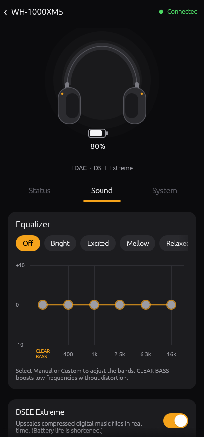
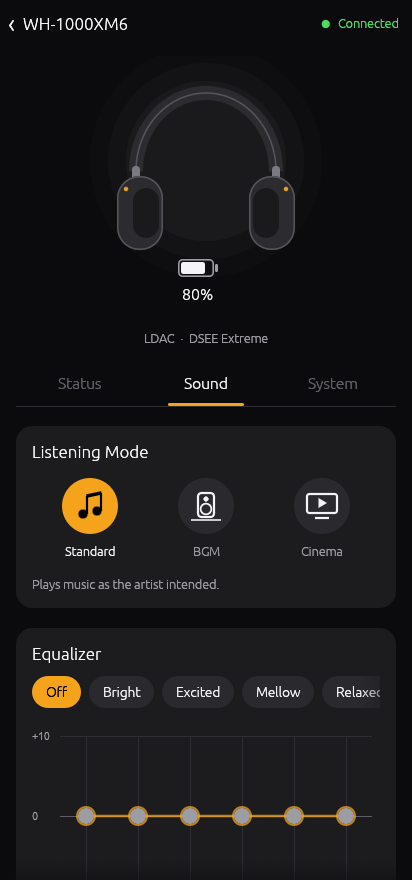
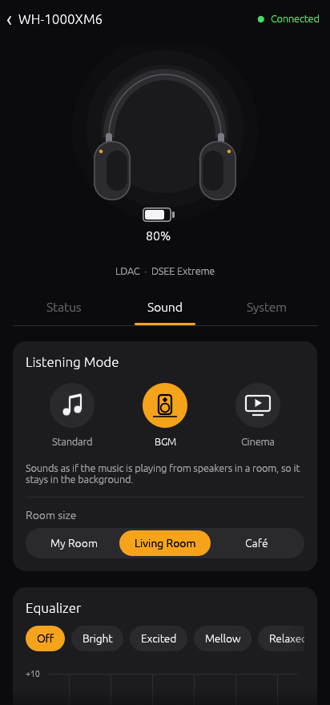

# Headphones Control for Linux (unofficial)

[](https://github.com/Al-Hadrusi/SonyGUIAudioDrivers/actions/workflows/ci.yml)

A desktop companion app for Sony Bluetooth headphones and earbuds, written in **100% safe Rust**
(`unsafe_code = "forbid"` is set for the whole crate, so the compiler rejects any `unsafe` block).

The interface is laid out like the mobile companion app: a phone-sized window with a product
illustration, battery levels, and **Status / Sound / System** tabs.

| Status | Sound | System | Earbuds |
|---|---|---|---|
|  |  |  |  |

| Listening Mode (WH-1000XM6) | BGM room size |
|---|---|
|  |  |

> This is an independent, unofficial project. It is not affiliated with or endorsed by Sony.
> No Sony artwork or logos are bundled; the product illustrations are drawn with vector shapes.

## Features

| Feature | Where |
|---|---|
| Noise Canceling / Ambient Sound / Off | Status |
| Ambient sound level (1–20), Focus on Voice | Status |
| Wind Noise Reduction | Status |
| Speak-to-Chat on/off | Status |
| Battery (headphones; earbuds L / R / case) | Header |
| Bluetooth codec (SBC / AAC / LDAC / aptX / LC3) | Header, Status |
| Auto Ambient Sound + sensitivity (WH-1000XM6) | Status |
| Play / pause / next / previous, music volume (0–30) | Status |
| Listening Mode: Standard / BGM (My Room, Living Room, Café) / Cinema (WH-1000XM6 and other models that support it) | Sound |
| Surround (VPT): Arena / Club / Outdoor Stage / Concert Hall (older V1 models that support it) | Sound |
| Equalizer: Clear Bass + 5 bands (−10…+10), or 10 bands 31 Hz–16 kHz (−6…+6) on the WH-1000XM6, with each model's presets and Manual / Custom slots | Sound |
| DSEE Extreme (upscaling) | Sound |
| Bluetooth connection quality: sound quality / stable connection | Sound |
| Speak-to-Chat sensitivity, voice focus, mode duration | System |
| Touch sensor control panel | System |
| Pause when taken off | System |
| Automatic power off | System |
| NC/AMB button: what the button cycles through | System |
| Voice guidance on/off and volume | System |
| Firmware version, power off, disconnect | System |
| Remembers the last headset and reconnects when it is switched on | Device list |
| System tray icon: switch NC / Ambient / Off, keeps running when the window is closed | Tray |

Both protocol generations are supported and detected automatically from the headset's init reply:

* **V1**: WH-1000XM3, WH-1000XM4, WF-1000XM3, ...
* **V2**: WH-1000XM5, WH-1000XM6, WF-1000XM4, WF-1000XM5, LinkBuds, ...

Settings a model doesn't have are hidden: each card only appears once the headset answers the
query for it.

For development, four **simulated devices** are built in: WH-1000XM6 (V2 with Listening Mode),
WH-1000XM5 (V2), WF-1000XM5 (V2 earbuds) and WH-1000XM4 (V1 with Surround). They speak the real wire
protocol, so every control can be tried without hardware. They are hidden unless the app is started
with `--demo`.

## Building and running

Install Rust from <https://rustup.rs>, then:

```bash
cargo run --release
```

For development, list the simulated devices too:

```bash
cargo run --release -- --demo
```

Or open one directly:

```bash
cargo run --release -- --demo WH-1000XM6 --tab sound
```

### Install (launcher, icon)

From the repository root, this builds the app and installs it for your user into `~/.local`
(binary, application-menu entry and icon):

```bash
./packaging/linux/install.sh
```

Remove it again with:

```bash
./packaging/linux/install.sh uninstall
```

Use `PREFIX=/usr/local` (with `sudo`) for a system-wide install.

### Linux (real headsets)

Bluetooth uses BlueZ over D-Bus, so the D-Bus development package is needed to build:

```bash
sudo apt install libdbus-1-dev pkg-config
```

1. Pair and connect the headset in your system's Bluetooth settings.
2. Start the app. The headset is listed under **Paired devices**; click it.

If the control channel can't be found through SDP, you can force an RFCOMM channel:

```bash
SONY_RFCOMM_CHANNEL=9 cargo run --release
```

### Gentoo

The project needs **Rust 1.95 or newer**. Check your version with `rustc --version`. If Portage's
Rust is older, install rustup (`emerge --ask dev-util/rustup`, then `rustup-init-gentoo`) or unmask a
newer `dev-lang/rust` / `dev-lang/rust-bin`.

```bash
sudo emerge --ask --noreplace sys-apps/dbus dev-util/pkgconf net-wireless/bluez media-libs/mesa x11-libs/libxkbcommon
```

On X11, `x11-libs/libxkbcommon` needs the `X` USE flag, because the window library loads
`libxkbcommon-x11.so` at runtime:

```bash
echo "x11-libs/libxkbcommon X" | sudo tee /etc/portage/package.use/headphones-control
```

Your kernel needs Bluetooth with RFCOMM: `CONFIG_BT`, `CONFIG_BT_RFCOMM`, `CONFIG_BT_BREDR` and
your adapter's driver (usually `CONFIG_BT_HCIBTUSB`). Check with:

```bash
zgrep -E "CONFIG_BT(_RFCOMM|_BREDR|_HCIBTUSB)?=" /proc/config.gz
```

Start BlueZ. With OpenRC:

```bash
sudo rc-update add bluetooth default && sudo rc-service bluetooth start
```

With systemd:

```bash
sudo systemctl enable --now bluetooth
```

Then pair the headset (for example with `bluetoothctl`: `scan on`, `pair <MAC>`, `trust <MAC>`,
`connect <MAC>`) and run `cargo run --release`.

#### Installing with Portage

`packaging/gentoo` is a small overlay with a live ebuild (`media-sound/headphones-control-9999`,
USE flags `bluetooth` and `tray`, both on by default). Register it with Portage by running this
from the root of your clone:

```bash
printf '[headphones-control]\nlocation = %s\n' "$PWD/packaging/gentoo" | sudo tee /etc/portage/repos.conf/headphones-control.conf
```

Live ebuilds are not keyworded, so accept it:

```bash
echo "media-sound/headphones-control **" | sudo tee /etc/portage/package.accept_keywords/headphones-control
```

Then install:

```bash
sudo emerge --ask media-sound/headphones-control
```

### System tray

The tray icon (StatusNotifierItem) works with KDE Plasma, XFCE, LXQt, waybar and GNOME with the
*AppIndicator* extension. Its menu switches between Noise Canceling, Ambient Sound and Off, and its
tooltip shows the battery level. On X11, closing the window keeps the app running in the tray (use
**Quit** in the tray menu to exit). On Wayland, and on desktops without a tray, closing the window
quits as usual.

### Settings file

The last headset and the *Connect automatically* switch are stored in
`~/.config/headphones-control/settings`.

### Troubleshooting

Run with `SONY_DEBUG=1` to print every message exchanged with the headset:

```bash
SONY_DEBUG=1 cargo run --release
```

Lines starting with `TX` are commands sent to the headset; lines starting with `RX` are its replies.
If a setting doesn't apply, open an issue with this output and your headset model.

### Windows / macOS

The app builds and runs, but only with the simulated devices (`--demo`). Real Bluetooth is only implemented for Linux so
far: add a `Transport` implementation in `src/transport/` to support another platform.

To build without Bluetooth support (no D-Bus needed):

```bash
cargo run --release --no-default-features
```

## Architecture

```
src/
├── lib.rs                  #![forbid(unsafe_code)]
├── config.rs               settings file (last headset, auto-connect)
├── protocol/
│   ├── frame.rs            framing: 0x3E … 0x3C, escaping, checksum, incremental decoder
│   ├── message.rs          request builders / notification parsers (bounds-checked, never panic)
│   └── session.rs          sequence numbers, ACKs, retries
├── transport/
│   ├── bluetooth.rs        BlueZ RFCOMM client (Linux, `bluetooth` feature)
│   └── simulator.rs        in-process headset emulator
├── worker.rs               background connection thread (GUI never blocks on I/O)
└── ui/                     egui front-end (theme, custom widgets, screens, tray icon)
```

The safety measures:

* The crate forbids `unsafe` code.
* All parsing of device data is bounds-checked and returns errors instead of panicking.
* Frame sizes are capped (`MAX_PAYLOAD`), so a corrupt length field can't make the app allocate a
  huge buffer.
* Values from the device (battery %, EQ bands, ambient level) are clamped to their valid ranges.
* Slider drags are merged in the worker so the headset isn't flooded with commands.

The protocol opcodes come from public reverse-engineering work by the open-source community
(Gadgetbridge, and mos9527's SonyHeadphonesClient for the WH-1000XM6 messages). Opcodes differ
between models and firmware versions, so the app reads each setting back from the headset where the
protocol allows it, and hides what the headset doesn't answer.

## Tests

```bash
cargo test
```

The tests cover frame encoding and escaping, checksum and oversize rejection, payload encoding,
fuzz-style truncated input, and full round-trips between the session/worker and the simulated
headset.

## License

MIT, see [LICENSE](LICENSE).
